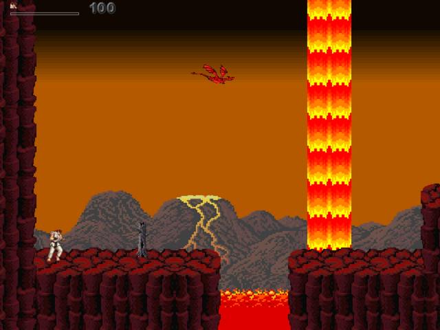
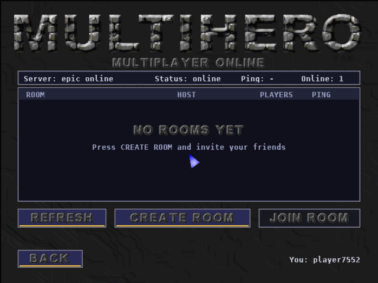

<p align="center">
  
</p>

<h1 align="center">MultiHero Online</h1>

<p align="center">
  <b>MultiHero 0.96</b> by <b>mhman</b> for <b>Windows and Linux</b> – the 2D multiplayer platform fighting game
  written in Blitz3D, running its original Blitz BASIC source through a Blitz → C++ transpiler and a lightweight
  native runtime, with <b>real-time online multiplayer</b> on 4 online servers – together with Android and browser
  players – and through Epic Online Services.
</p>

<p align="center">
  
  
  
  
</p>

<p align="center">
  
  
</p>

## Download and play

Get the latest version from **[Releases](https://github.com/richardyusan/multihero-online/releases)**:

| System | File | Start |
|---|---|---|
| Windows 10/11 (64-bit) | `MultiHero-<version>-windows-x64.zip` | unzip, double-click `MultiHero.exe` |
| Linux (64-bit) | `MultiHero-<version>-linux-x64.tar.gz` | `tar xzf …`, then `./multihero` |

No installation needed. Keep the `assets` folder next to the program. Saves and settings go to
`%APPDATA%\MultiHero` (Windows) or `~/.local/share/MultiHero` (Linux); an empty file `portable.txt` next to the
program keeps them in `./save` instead.

Android version: [richardyusan/multihero-android](https://github.com/richardyusan/multihero-android) ·
browser version: [richardyusan/multihero-web](https://github.com/richardyusan/multihero-web)

## Features

- The original game: Adventure mode (50 stages), VS mode, Capture the Flag, CPU opponents, items, unlocks, saves
- **MULTIPLAYER ONLINE** – real-time online VS matches for up to 4 players on **4 online servers** (Asia Tenggara,
  Asia Timur, US, Eropa): public rooms, private rooms with a code, pick your fighter, host chooses lives and stage
  (picture grid), READY / START, every player's connection light and ping during the match, a notice when someone
  leaves (the CPU takes over). **Same rooms as the Android version and the web version** (browser, phone and PC in one
  match). The **epic online** button switches to the Epic Online Services lobby (no Epic account needed).
- **Up to 4 game pads** (Xbox, PlayStation, generic – anything SDL2 knows): every pad is its own player,
  also in the menus – local VS and Adventure with friends on one PC
- Keyboard and mouse like the original; touch screens (Windows tablets) get the on-screen controls of the Android version
- **CHEATS** page in the main menu (click with the mouse): **INFINITE HEALTH** / **INFINITE JUTSU** for Adventure
  mode and **UNLOCK ALL CHARACTERS + MAPS**, each ON/OFF (saved in `port_cheats.cfg`)
- Sharp scaling to any window size, full screen with **Alt+Enter**, original speed (54 fps game logic)
- Fixes over the original 0.96 source: enemies that never attacked (Venom on stage 50, Shredder, Thug, Pig)

## Controls

| Action | Keyboard (player 1, default) | Game pad |
|---|---|---|
| Move | W A S D | D-pad / left stick |
| Attack | N | A |
| Jump | M | B |
| Special | H | X |
| Block | Space | Y, LT, RT |
| Throw / grab | J | LB, RB |
| Super move (jutsu) | Block + Special | Y + X |
| OK / menu | Enter / Esc | Start / Back |
| Full screen | Alt+Enter | – |

Change the keyboard keys in **Options → Controls**. Menus are used with the mouse (player 1) and the pads
(players 2-4 move their own pointer and click with attack).

## Online play

Main menu → **MULTIPLAYER ONLINE** opens the lobby of the online servers
([multihero-server](https://github.com/richardyusan/multihero-server), a Cloudflare Worker). PC, Android and
browser ([multihero-web](https://github.com/richardyusan/multihero-web)) players see the same rooms and play in the
same match. Buttons at the bottom of the lobby:

- **server** – Server 1–4 with ping and players online
- **epic online** – the Epic Online Services lobby (PC and Android), **online servers** switches back
- **name** – your name in the rooms; **enter room code** in the room list joins a friend's private room

How it works: every machine runs the same deterministic game simulation (same random seed, stage and
characters) and only the players' buttons travel – through the server (a relay, rooms by code) or over Epic's
peer-to-peer network (lockstep with a small input delay chosen from the ping). The game is compiled with `-ffp-contract=off` so the float maths is identical
on PCs (x86-64) and phones (ARM64) – tested with an x86-64 and an ARM64 client: identical game state checksums
for a whole match; a PC (Linux) and a browser (WebAssembly) played a whole match on the online servers without desync. Details: [docs/ONLINE.md](docs/ONLINE.md).

## Building

Both versions are built on Linux (Ubuntu 24.04 / WSL); the Windows version is cross-compiled with MinGW-w64.

```bash
sudo apt install g++ g++-mingw-w64-x86-64 libsdl2-dev zip python3-pil
# SDL2 for MinGW: SDL2-devel-2.30.x-mingw.tar.gz from https://github.com/libsdl-org/SDL/releases
#   unpack and set SDL2_MINGW=/path/to/SDL2-2.30.x
# Epic Online Services SDK (free, dev.epicgames.com): unpack the parts the build needs
python3 tools/setup_eos.py EOS-SDK-<build>-Release-v1.19.x.zip       # -> third_party/eos/
cp config/online.local.cfg.example config/online.local.cfg            # your EOS product / client ids
# Mbed TLS (secure connection to the online servers), downloaded and checked:
python3 tools/fetch_mbedtls.py                                        # -> third_party/mbedtls/
# game data: copy the original MultiHero096 folder into ./game (not included, see game/README.md)

./build_desktop.sh windows     # -> dist/MultiHero-1.8.0-windows-x64.zip
./build_desktop.sh linux       # -> dist/MultiHero-1.8.0-linux-x64.tar.gz
```

`NO_EOS=1` builds without online play, `CODE_ONLY=1` only the program. The same source tree also builds the
Android APK (`build_android.sh`, see [BUILD.md](BUILD.md)) and the browser version (`build_web.sh`).

| Path | Contents |
|---|---|
| `src/` | Original MultiHero 0.96 Blitz source; port additions: `online.bb`, `port.bb`, moves of four enemies, lines marked `;[android port]` |
| `tools/` | `bb2cpp.py` transpiler, asset preparation, EOS setup |
| `runtime/` | Blitz 2D runtime; `desktop_main.cpp` = Windows/Linux backend (SDL2), also Android, web and test backends |
| `runtime/net/` | Online layer: online servers (WebSocket + TLS client), Epic Online Services (lobby + P2P), lockstep netplay, VPS relay, offline demo |
| `config/` | `online.cfg`; private `online.local.cfg` with the EOS credentials (not in git) |
| `server/` | Optional lobby/relay server for a VPS |

## Credits

- **MultiHero** – original game, design, code and level editor by **mhman**.
  This port exists thanks to mhman's work and to the decision to share the MultiHero 0.96 source code.
- **PC port** – Blitz → C++ transpiler, native runtime, Windows/Linux and online play (this repository).
- Characters, sprites and sounds used by the game belong to their respective owners (see [NOTICE.md](NOTICE.md)).

## License

The porting code (`tools/`, `runtime/`, `android/`, `scripts/`, `server/`, `config/`, `src/online.bb`, `src/port.bb`,
build files, docs) is released under the [MIT License](LICENSE). The original game source in `src/` belongs to its
author, **mhman**, and the characters used by the game belong to their respective owners. See [NOTICE.md](NOTICE.md).
MultiHero is a non-commercial fan project and is not affiliated with any of those companies.
The Epic Online Services SDK is not included; it is used under Epic's terms.

## Donation

To support this porting project, you can donate:

| Koin | Jaringan | Alamat |
|---|---|---|
| BTC | Bitcoin | `1455F5BFc41XKc1Tjg8himciuiZXtHdrsz` |
| ETH | Ethereum (ERC-20) | `0x411bd0C7a9A18d5A66B79F8C8c9D2b214D4A8214` |
| BNB | BNB Smart Chain (BEP-20) | `0x411bd0C7a9A18d5A66B79F8C8c9D2b214D4A8214` |
| USDT | ERC-20 / BEP-20 | `0x411bd0C7a9A18d5A66B79F8C8c9D2b214D4A8214` |

Details and QR code: [DONATE.md](DONATE.md)
